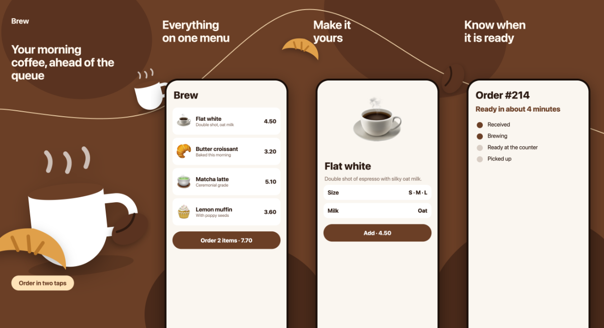
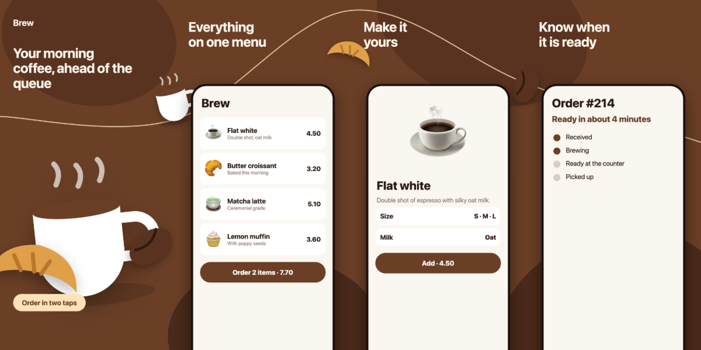

# store-screenshots

A [Claude Code](https://claude.com/claude-code) skill that turns raw app screenshots into App Store and Google Play
listing images the way the big food, ride and shopping apps do them: a short headline, the phone bleeding off the bottom,
and **one background that runs through the whole row**, so shapes, a line and dishes or products cross the borders between
pictures. Swipe through the listing and it feels like one surface.

Ask for it in plain words: *"make store screenshots for my app"*, *"Google Play screenshots from these"*,
*"the listing images look flat, style them"*. The skill picks the story, writes the config, renders the row, checks the
pixel sizes and shows you the whole row in one picture.



## What it does

- **Builds the row from the app's own screenshots.** A config lists the devices (pixel sizes) and the pictures (headline
  and file); `scripts/render.mjs` makes `out/<device>/<picture>.png`, refuses a picture of the wrong size and writes
  `out/preview-<device>.png`.
- **One canvas, many slices.** The pictures are cut from one wide background. A cup on the seam is half in picture 2 and
  half in picture 3. A hero picture without a phone opens the row.
- **Knows the stores.** Sizes and limits for iPhone 6.9", iPad 13", Play phone and tablet, the feature graphic
  (`references/store-specs.md`, dated).
- **Writes and checks the copy.** Two lines, a verb or a benefit, true today; the design rules explain why and what
  makes a row look cheap (`references/design-rules.md`).
- **No dependencies.** Node 20+ and Chrome or Chromium. Works the same with any app: the example below is a made-up coffee
  app, the same config shape styled a real food-ordering app.

| Play phone, 1080 x 2160 |
|---|
|  |

## Install

**As a plugin via the marketplace (recommended).**

```
/plugin marketplace add MubiZero/store-screenshots
/plugin install store-screenshots@mubizero-store-screenshots
```

or from the CLI:

```bash
claude plugin marketplace add MubiZero/store-screenshots
claude plugin install store-screenshots@mubizero-store-screenshots
```

**Manual.** Copy the skill folder into your skills directory:

```bash
git clone https://github.com/MubiZero/store-screenshots.git
cp -r store-screenshots/skills/store-screenshots ~/.claude/skills/store-screenshots
```

Restart Claude Code. The skill triggers on store-screenshot requests; there is nothing to configure.

## Use it without Claude

```bash
node skills/store-screenshots/examples/demo/make-raw.mjs                                   # the demo's raw screens
node skills/store-screenshots/scripts/render.mjs skills/store-screenshots/examples/demo/config.json
node skills/store-screenshots/scripts/selftest.mjs                # checks sizes and the failure path
```

Copy `skills/store-screenshots/examples/demo/config.json`, point `devices[].raw` at your screenshots, change the `theme`, the `slots` titles and
the `decor`. Every option is in [`skills/store-screenshots/references/config.md`](skills/store-screenshots/references/config.md).

## What is inside

```
.claude-plugin/              plugin + marketplace manifests (install via /plugin)
skills/store-screenshots/
  SKILL.md                   the flow: screens -> story -> brand -> config -> render -> look -> hand over
  scripts/render.mjs         the renderer (Chrome headless, no dependencies)
  scripts/selftest.mjs       renders the demo and checks sizes and the failure path
  references/                config.md, store-specs.md, design-rules.md, capture.md
  examples/demo/             a made-up coffee app: raw screens, decoration, a working config
demos/                       the two preview rows above
```

## Limits

- Portrait phone and tablet pictures; no landscape, no video previews, no per-language batch (run once per language).
- The phone frame is a plain bezel, not a device-specific mockup: stores accept it, and it never goes out of date.
- Store requirements change; `references/store-specs.md` says when it was checked. Open the current store page before a release.

## License

[MIT](LICENSE) © 2026 MubiZero
